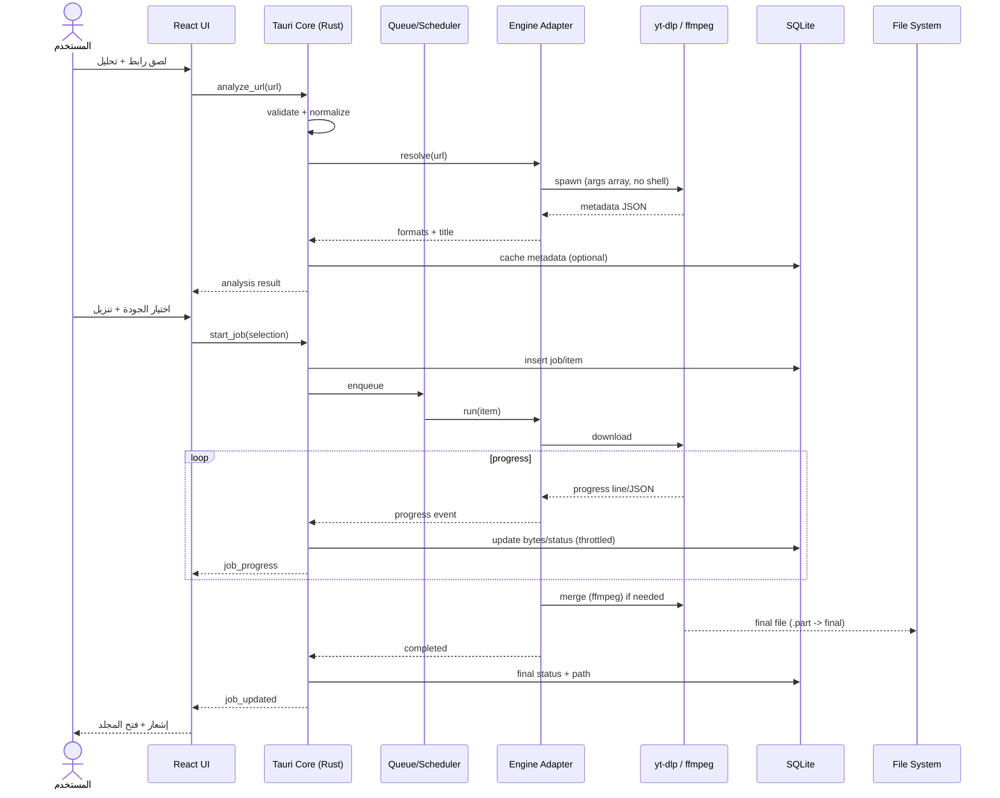
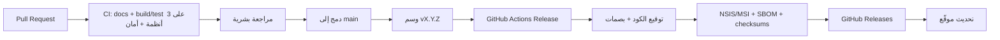

# بنية النظام — Tanzeel

| الحقل | القيمة |
| --- | --- |
| الإصدار | 0.1 (مسودة) |
| التاريخ | 2026-10-30 |
| الحالة | مقترح — بانتظار موافقة المالك |
| النطاق | Windows 10 22H2+ / Windows 11، x64 |
| الوثائق المرتبطة | [PRD](PRD.md)، [ROADMAP](ROADMAP.md)، [ADRs](adr/) |

> **تنبيه:** لا يوجد كود تطبيق بعد. هذه بنية مقترحة، وكل ما فيها قابل للتغيير قبل المرحلة 1. ما لم يُثبته اختبار يُكتب عنه: **لم يُختبر**.

---

## 1. نظرة عامة

يتكوّن «تنزيل» من أربع طبقات رئيسية:

1. **واجهة سطح المكتب:** WebView تعرض React/TypeScript، عربية RTL أولًا.
2. **النواة:** Rust inside Tauri، تملك المنطق والحالة والتحقق والتنسيق.
3. **المحركات:** محمّل HTTP أصلي للملفات المباشرة، و`yt-dlp` كعملية فرعية للفيديوهات، و`ffmpeg` للدمج والتحويل.
4. **التخزين:** SQLite للبيانات المنظمة، ونظام الملفات للمحتوى، وWindows DPAPI/Credential Manager للأسرار.

الفكرة المركزية: **الواجهة لا تلمس الملفات ولا الشبكة مباشرة.** كل عملية حساسة تمر عبر أوامر Tauri محددة، تتحقق منها النواة، وتعود النتائج كأحداث موثوقة.

## 2. مبادئ البنية

- **حدود واضحة:** الواجهة للعرض، النواة للقرار، المحركات للتنفيذ.
- **عملية واحدة مسؤولة:** كل تنزيل له مالك واحد وحالة واحدة، لا كتابة متزامنة إلى الملف نفسه.
- **الفشل قابل للاستئناف:** حالة محفوظة، ملفات مؤقتة، إعادة محاولة آمنة.
- **الأمان بالتصميم:** لا shell، لا تنفيذ تلقائي، لا ثقة في بيانات المنصة.
- **قابلية الاستبدال:** محرك التنزيل خلف واجهة (trait) حتى يمكن تغييره دون إعادة بناء المنتج.
- **الاختبار بلا شبكة حقيقية:** كل الاختبارات الآلية تعمل على خوادم وهمية وعينات مسجلة.
- **الخصوصية افتراضيًا:** لا تتبّع، لا حساب، لا إرسال بيانات إلا بطلب المستخدم.

## 3. مخطط السياق

```mermaid
flowchart LR
    U[المستخدم] -->|لصق رابط / إعدادات| UI[واجهة React داخل Tauri]
    UI -->|أوامر Tauri| CORE[نواة Rust]
    CORE -->|قراءة/كتابة| DB[(SQLite)]
    CORE -->|ملفات| FS[مجلد التنزيل]
    CORE -->|HTTP/HTTPS| NET[الشبكة]
    CORE -->|عملية فرعية| YTDLP[yt-dlp]
    CORE -->|عملية فرعية| FFMPEG[ffmpeg]
    YTDLP -->|وسائط| NET
    FFMPEG -->|دمج/تحويل| FS
    YTDLP -->|تقدم/بيانات| CORE
    FFMPEG -->|تقدم/أخطاء| CORE
    UI <--|أحداث| CORE
    CORE -->|فحص تحديث| GH[GitHub Releases]
    CORE -->|أسرار مشفرة| DPAPI[Windows DPAPI]
```

## 4. المكونات

| المكوّن | المسؤولية | لا يفعل |
| --- | --- | --- |
| `apps/desktop` (React + TS) | العرض، التفاعل، الترجمة، RTL، إدارة حالة الواجهة | لا يقرأ ملفات، لا يتصل بالشبكة، لا ينفّذ أوامر |
| `apps/desktop/src-tauri` | جسر Tauri، تسجيل الأوامر، دورة حياة النافذة، التحديث | لا يحتوي منطق تنزيل |
| `crates/tanzeel-core` | نموذج المهام، الحالات، التحقق، التنسيق، الأخطاء، الأحداث | لا يعرف تفاصيل يوتيوب |
| `crates/tanzeel-download` | واجهة المحرك، محمّل HTTP، محوّل yt-dlp، محوّل ffmpeg | لا يكتب في الواجهة |
| `crates/tanzeel-storage` | SQLite، الترحيلات، المستودعات، النسخ الاحتياطي | لا يقرر سياسة المنتج |
| `crates/tanzeel-platform` | تكامل ويندوز: DPAPI، الإشعارات، tray، فتح المجلد، عملية فرعية | لا يحتوي منطق أعمال |
| `apps/desktop/src/i18n` | ملفات `ar` و`en`، ICU، اختبارات التكافؤ | لا نصوص مكتوبة في المكوّنات |
| `sidecars/` | `yt-dlp.exe` و`ffmpeg.exe` مثبّتان ببصمة معروفة | لا تُعدَّل يدويًا داخل المستودع |

### 4.1 الشكل المقترح للمستودع

```text
tanzeel/
├─ apps/
│  └─ desktop/
│     ├─ src/                 # React + TypeScript
│     ├─ src-tauri/           # Tauri shell + commands
│     └─ package.json
├─ crates/
│  ├─ tanzeel-core/           # domain, validation, queue
│  ├─ tanzeel-download/       # engine adapters
│  ├─ tanzeel-storage/        # SQLite + migrations
│  └─ tanzeel-platform/       # Windows integration
├─ sidecars/                  # manifests + checksums; binaries fetched in CI
├─ docs/
│  ├─ PRD.md
│  ├─ ARCHITECTURE.md
│  ├─ ROADMAP.md
│  └─ adr/
├─ .github/
│  ├─ workflows/
│  └─ ISSUE_TEMPLATE/
├─ AGENTS.md
├─ README.md
└─ LICENSE
```

هذا الشكل مقترح، ويُثبَّت في المرحلة 1. لا تُنشأ مجلدات فارغة قبل الحاجة إليها.

## 5. نموذج العمليات



### 5.1 قواعد العملية الفرعية

- تُشغَّل `yt-dlp` و`ffmpeg` كعمليات فرعية مباشرة، بوسائط مصفوفة، **بدون shell**.
- تُمرَّر `--ignore-config` و`--no-exec` (أو ما يعادلها) لمنع إعدادات أو تنفيذ غير متوقع.
- تُحدَّد مهلة، ويُقتل شجرة العمليات بالكامل عند الإلغاء (Job Object على ويندوز).
- تُنظَّف البيئة من المتغيرات الحساسة قبل التشغيل.
- تُلتقط المخرجات بحجم أقصى، وتُصنَّف كبيانات غير موثوقة.
- لا تُقرأ أي أوامر من مخرجات المحرك؛ تُقرأ الحقول المتوقعة فقط.

## 6. تدفق البيانات

### 6.1 إضافة مهمة

1. الواجهة ترسل رابطًا خامًا.
2. النواة تطبّعه وتتحقق من المخطط والطول والتحويلات.
3. إن كان الرابط مباشرًا، تُنشأ مهمة ملف.
4. إن كان منصة، يُستدعى محوّل المحرك لجلب البيانات.
5. المستخدم يختار الصيغة.
6. تُحفظ المهمة والعناصر في SQLite بحالة `queued`.
7. الجدولة تختار عنصرًا حسب الأولوية والحد الأقصى للتزامن.
8. المحرك ينزّل إلى ملف مؤقت، ثم يعيد التسمية ذريًا.
9. تُحدَّث الحالة، ويُرسل حدث للواجهة.

### 6.2 استعادة الحالة بعد إعادة التشغيل

1. عند البدء، تقرأ النواة المهام غير المنتهية.
2. تُحوَّل الحالات العابرة (`fetching`، `processing`) إلى `paused` أو `queued` حسب السلامة.
3. تُفحص الملفات المؤقتة، وتُعاد المهام القابلة للاستئناف.
4. تُنظَّف الملفات المؤقتة اليتيمة بعد مدة محددة.
5. لا تُعاد محاولة المهام الملغاة أو المكتملة.

## 7. نموذج البيانات

### 7.1 الجداول المقترحة

| الجدول | الغرض | حقول أساسية |
| --- | --- | --- |
| `schema_migrations` | إصدار المخطط | `version`, `applied_at` |
| `settings` | إعدادات مكتوبة | `key`, `value_json`, `updated_at` |
| `jobs` | مهمة المستخدم | `id`, `kind`, `source_url`, `platform`, `title`, `status`, `priority`, `output_dir`, `error_code`, `created_at`, `updated_at` |
| `job_items` | ملف داخل مهمة | `id`, `job_id`, `source_url`, `title`, `format_id`, `quality`, `output_path`, `temp_path`, `bytes_total`, `bytes_done`, `status`, `error_code`, `checksum`, `created_at`, `updated_at` |
| `history_events` | أحداث قابلة للتدقيق | `id`, `job_id`, `item_id`, `event`, `at`, `metadata_json` |
| `secret_refs` | مراجع أسرار فقط | `key`, `provider`, `created_at` — **لا تُخزَّن القيمة** |

### 7.2 قواعد

- SQLite في وضع WAL، كاتب واحد، قراءات متزامنة.
- كل ترحيل قابل للتراجع أو مصحوب بنسخة احتياطية قبل التنفيذ.
- لا تُخزَّن الملفات الكبيرة كـ BLOB.
- تُحذف السجلات القديمة وفق سياسة قابلة للضبط (افتراضيًا 90 يومًا للسجل، 7 أيام للسجلات النصية).
- تصدير السجل JSON، واستيراده اختياري لاحقًا.
- Cookies والرموز تُخزَّن في Windows Credential Manager أو DPAPI، ويُشار إليها فقط من قاعدة البيانات.

### 7.3 الملفات

- مجلد التنزيل يختاره المستخدم.
- ملف مؤقت: `<name>.<job-id>.part` داخل نفس المجلد لضمان إعادة تسمية ذرية.
- عند الاكتمال: إعادة تسمية إلى الاسم النهائي، مع تجنّب التصادم بإضافة لاحقة.
- أسماء الملفات تُنقّى من `<>:"/\|?*` والمحارف التحكمية والأسماء المحجوزة (`CON`, `PRN`, `AUX`, `NUL`, `COM1`...).
- يُمنع أي مسار نهائي خارج مجلد التنزيل بعد `canonicalize`.
- عند الفشل، يبقى المصدر الأصلي والملف المؤقت وفق سياسة واضحة.

## 8. عقود IPC

### 8.1 أوامر مقترحة

| الأمر | المدخل | المخرج | ملاحظات |
| --- | --- | --- | --- |
| `analyze_url` | `url` | `Analysis` | لا يبدأ تنزيلًا |
| `start_job` | `analysis_id` أو `url` + `selection` | `Job` | يتحقق من الاختيار |
| `pause_job` | `job_id` | `Job` | قابل للاستئناف |
| `resume_job` | `job_id` | `Job` | يتحقق من الحالة |
| `cancel_job` | `job_id` | `Job` | ينظّف المؤقت |
| `retry_job` | `job_id` | `Job` | يحتفظ بالإعدادات |
| `list_jobs` | `filter` | `Job[]` | مرقّم |
| `get_job` | `job_id` | `Job` | يشمل العناصر |
| `open_folder` | `job_id` أو `path` | `()` | يتحقق من المسار |
| `delete_history` | `ids` أو `all` | `()` | لا يحذف الملفات |
| `get_settings` | `()` | `Settings` | — |
| `update_settings` | `SettingsPatch` | `Settings` | تحقق كامل |
| `export_diagnostics` | `destination` | `path` | لا يرسل تلقائيًا |
| `check_update` | `()` | `UpdateInfo` | قابل للتعطيل |

### 8.2 أحداث مقترحة

| الحدث | الحمولة | معدل |
| --- | --- | --- |
| `job_updated` | `Job` | عند تغير الحالة |
| `item_progress` | `item_id`, `bytes_done`, `bytes_total`, `speed`, `eta` | مخفّض إلى 2/ثانية |
| `job_error` | `job_id`, `code`, `message` | عند الفشل |
| `update_available` | `version`, `notes_url` | عند الفحص |
| `engine_log` | `level`, `message` | فقط في وضع التشخيص |

كل الأوامر تتحقق من الأنواع والحدود. لا تُقبل معرّفات غير موجودة، ولا مسارات مطلقة من الواجهة إلا بعد تحقق.

## 9. حدود الأمان

### 9.1 الواجهة

- WebView تعرض محتوى محليًا فقط، بسياسة CSP صارمة.
- لا تُحمَّل موارد بعيدة داخل الواجهة.
- لا يُستخدم HTML غير موثوق؛ كل بيانات المنصة تُعرض كنص.
- لا تصل الواجهة إلى نظام الملفات أو الشبكة مباشرة.
- صلاحيات Tauri في حدها الأدنى.

### 9.2 النواة

- تتحقق من كل رابط: المخطط، الطول، التحويلات، العناوين الخاصة.
- تمنع shell injection وpath traversal.
- تحدد المهلات وأحجام الاستجابة القصوى.
- تُخفي الرموز في السجلات.
- تتحقق من بصمة المحركات قبل التشغيل.
- تتحقق من توقيع التحديث قبل التثبيت.

### 9.3 الشبكة

- `http/https` فقط.
- رفض `localhost` والشبكات الخاصة افتراضيًا، مع خيار متقدم صريح.
- حد لإعادات التوجيه، ومنع التحويل إلى مخطط غير مسموح.
- مهلة اتصال وقراءة.
- دعم وكيل اختياري لاحقًا، دون تسجيل بياناته.
- لا تُرسل cookies إلا للمضيف المقصود.

### 9.4 الملفات

- تطبيع المسارات والتحقق منها بعد `canonicalize`.
- منع الكتابة خارج مجلد التنزيل.
- أسماء آمنة، وحد لطول المسار.
- عدم اتباع الروابط الرمزية أو نقاط إعادة التحليل بشكل أعمى على ويندوز.
- مساحة قرص كافية قبل البدء إن أمكن.

### 9.5 المحركات الخارجية

- تُثبَّت النسخ في المستودع بملف manifest وبصمة SHA-256.
- تُحمَّل في CI أو أثناء البناء من مصدر رسمي، لا من رابط عشوائي.
- تُفحص البصمة قبل التشغيل.
- تُحدَّث مع إصدار التطبيق في v1، ثم عبر قناة موقعة لاحقًا.
- تراخيصها وإشعاراتها مضمّنة في «حول» وفي حزمة الإصدار.

## 10. الأخطاء والاستئناف

### 10.1 تصنيف الأخطاء

| الرمز | المعنى | إعادة المحاولة |
| --- | --- | --- |
| `NETWORK` | انقطاع أو مهلة | نعم، بتباعد متزايد |
| `RATE_LIMITED` | 429 أو حد منصة | نعم، مع احترام `Retry-After` |
| `NOT_FOUND` | محتوى محذوف | لا |
| `PRIVATE` | يحتاج تسجيل دخول | لا، مع شرح |
| `DRM_PROTECTED` | محمي تقنيًا | لا، مع شرح الحد |
| `GEO_BLOCKED` | محظور جغرافيًا | لا |
| `UNSUPPORTED` | غير مدعوم | لا |
| `DISK_FULL` | لا مساحة | لا، حتى يفرغ المستخدم مساحة |
| `PERMISSION` | صلاحية ملفات | لا |
| `ENGINE_FAILED` | فشل المحرك | حسب التصنيف |
| `MERGE_FAILED` | فشل الدمج | نعم، مع إبقاء المصدر |
| `CANCELLED` | إلغاء المستخدم | لا |
| `INTERNAL` | خطأ غير متوقع | مرة واحدة، ثم تقرير |

### 10.2 سياسة إعادة المحاولة

- إعادة المحاولة للأخطاء العابرة فقط.
- تباعد متزايد مع عشوائية (exponential backoff + jitter).
- حد أقصى قابل للضبط، افتراضيًا 3 محاولات.
- لا إعادة محاولة تلقائية لا نهائية.
- تُسجَّل المحاولات في `history_events` دون بيانات حساسة.

### 10.3 الاستئناف

- الملفات المباشرة: `Range` إن دعمه الخادم، وإلا بدء آمن.
- الفيديوهات: `yt-dlp --continue` مع ملفات مؤقتة.
- قاعدة البيانات: تُحدَّث الحالة بشكل دوري، لا عند كل بايت.
- عند الازدواج: عنصر واحد فقط يملك الملف.

## 11. الأداء والتزامن

- حد افتراضي 3 تنزيلات متزامنة، قابل للضبط.
- قد يكون هناك حد لكل مضيف لتجنب الحظر.
- تحديثات التقدم تُخفَّض قبل إرسالها للواجهة (2/ثانية).
- عمليات SQLite الثقيلة على خيط منفصل أو كاتب مخصص.
- الدمج والتحويل في عملية فرعية، لا في خيط الواجهة.
- أهداف مبدئية (لم تُختبر): بدء < 3 ثوانٍ، خمول < 200 ميجابايت، واجهة متجاوبة.

## 12. الترجمة وRTL

- `i18next` + `react-i18next` مقترح.
- `ar` هي اللغة الافتراضية، و`en` خيار فوري.
- كل النصوص في ملفات JSON، مع مفاتيح ثابتة.
- `dir="rtl"` على مستوى الجذر، وCSS خصائص منطقية (`margin-inline`, `padding-inline`) لا `left/right`.
- الأرقام والتواريخ عبر `Intl` مع إعداد مستخدم.
- خط عربي مفتوح المصدر يُختار في مرحلة التصميم، مع بديل نظام.
- اختبارات: تكافؤ المفاتيح، عدم وجود نصوص صلبة، لقطات RTL/LTR، نص طويل، جمع عربي.
- لا ترجمة آلية غير مراجعة في الإصدار.

## 13. الاختبارات

| المستوى | ماذا يغطي | أين يعمل |
| --- | --- | --- |
| وحدة | التحقق، الحالات، الأسماء، التنسيق، الترجمة | كل الأنظمة |
| تكامل | SQLite، ترحيلات، محمّل HTTP مع خادم وهمي | كل الأنظمة |
| عقد | أوامر/أحداث IPC، مخططات JSON | كل الأنظمة |
| محرك | مغلف yt-dlp بمخرج مسجل، لا شبكة | كل الأنظمة |
| واجهة | مكونات، RTL/LTR، وصول | كل الأنظمة (jsdom) |
| شامل | تدفق كامل على ويندوز | ويندوز فقط |
| يدوي | يوتيوب حقيقي، مثبّت، تحديث | ويندوز، موثّق |

- لا شبكة حقيقية في CI.
- عينات صغيرة مرخّصة أو مولّدة محليًا.
- كل خطأ جديد يحتاج اختبارًا يعيد إنتاجه.
- لا تُقبل اختبارات معلّقة دون Issue وسبب.

## 14. البناء والإصدار



- بناء الإصدار فقط من وسم على `main`.
- مثبّت NSIS افتراضيًا (تثبيت لكل مستخدم، بلا صلاحيات إدارية)، وMSI اختياري لاحقًا.
- توقيع الكود إن توفرت شهادة؛ وإلا يُعلَن الإصدار «غير موقّع» مع تحذير.
- تحديث Tauri مع بيان موقّع، ورفض التوقيع الخاطئ.
- SBOM، قائمة تراخيص، وبصمات SHA-256 لكل ملف.
- لا بناء يدوي ولا رفع يدوي للأصول.

## 15. القرارات المرتبطة

| القرار | الوثيقة |
| --- | --- |
| الرخصة | [ADR-0001](adr/0001-license.md) |
| إطار سطح المكتب | [ADR-0002](adr/0002-desktop-framework.md) |
| لغة النواة والواجهة | [ADR-0003](adr/0003-core-language.md) |
| محرك التنزيل | [ADR-0004](adr/0004-download-engine.md) |
| التخزين | [ADR-0005](adr/0005-data-storage.md) |
| الترجمة وRTL | [ADR-0006](adr/0006-i18n-rtl.md) |
| الإصدارات والتحديثات | [ADR-0007](adr/0007-release-updates.md) |
| الأمان والخصوصية | [ADR-0008](adr/0008-security-privacy.md) |
| الاختبارات وCI | [ADR-0009](adr/0009-testing-ci.md) |

## 16. أسئلة مفتوحة

1. هل نبدأ بـ Tauri 2 أم نختار Electron لتسريع التنفيذ؟
2. هل نفصل النواة في مكتبة Rust مستقلة قابلة للاستخدام بدون Tauri؟
3. هل نستخدم `rusqlite` أم `sqlx`؟ (تفصيل تنفيذي، لا يغيّر القرار)
4. هل نضيف دعم cookies في v1 أم نؤجله؟
5. هل نسمح بالشبكة المحلية افتراضيًا؟
6. ما سياسة الاحتفاظ بالسجل التي يريدها المالك؟
7. هل نضيف قناة تحديث تجريبية؟
8. هل نوقّع الكود بشهادة مدفوعة أم نبدأ غير موقّع؟
