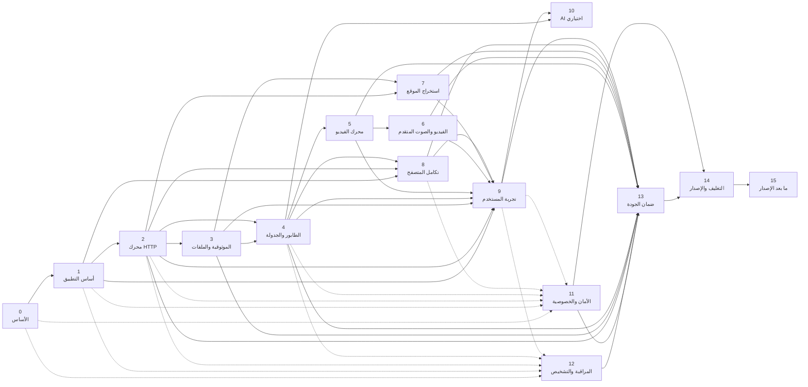

# خريطة اعتماد المراحل — Tanzeel

| الحقل | القيمة |
| --- | --- |
| الإصدار | 1.0 |
| التاريخ | 2026-10-31 |
| الحالة | `DESIGNED` — تخطيط اعتماد، لا تنفيذ |
| المرجع | [TANZEEL_MASTER_ROADMAP.md](TANZEEL_MASTER_ROADMAP.md) |
| الغرض | منع البدء المبكر، وإظهار المسار الحرج والعمل المتوازي والمخاطر |

> **قاعدة:** لا تُعتبر المرحلة مكتملة بمجرد انتهاء الكود. الاعتماد يعني اجتياز بوابة الخروج بالأدلة. المراحل الأمنية/التشخيصية مسارات مستمرة، وليست أعمالًا تُؤجل إلى النهاية.

---

## 1. الرسم العام



**ملاحظة قراءة:** الأسهم المتقطعة تعني «مسار مستمر يجب أن يكون مكتملًا عند البوابة»، لا «انتظر حتى النهاية». الأمان والتشخيص يبدآن من المرحلة 0/1.

---

## 2. الاعتماد المباشر

| المرحلة | تعتمد على | السبب |
| --- | --- | --- |
| 0 | — | تأسيس المستودع والحوكمة |
| 1 | 0 | تحتاج CI/قواعد/قرارات أساسية |
| 2 | 1 | تحتاج shell/عقد IPC/نموذج إعدادات |
| 3 | 2 | تحتاج ملفات مؤقتة وتنزيلًا فعليًا لاختبار السلامة |
| 4 | 2، 3 | تحتاج محركًا وملفات آمنة قبل الطابور |
| 5 | 2، 4 | تحتاج تنزيلًا/مهامًا/طابورًا لمصدر الفيديو |
| 6 | 5 | تحتاج تحليل/تنزيل فيديو أساسي |
| 7 | 2، 3 | تحتاج HTTP وملفات آمنة ومعاينة |
| 8 | 1، 2، 4 | تحتاج واجهة، تنزيلًا، وطابورًا؛ يمكن تصميم الإضافة مبكرًا |
| 9 | 1–8 | تحتاج مسارات حقيقية لصقلها |
| 10 | 4، 11، 12 | تحتاج بيانات/خصوصية/تشخيصًا؛ وليس مسارًا حرجًا |
| 11 | 0–9 (مستمر) | يغطي كل سطح، ويصبح بوابة قبل 14 |
| 12 | 0–9 (مستمر) | يُبنى مع كل ميزة، ويصبح بوابة قبل 14 |
| 13 | 2–12 | يحتاج كل ما يدخل v1 |
| 14 | 13، 11، 12 | لا إصدار بلا جودة/أمان/تشخيص |
| 15 | 14 | لا توسع قبل استقرار v1 |

---

## 3. المسار الحرج

**المسار الحرج المقترح إذا بقي نطاق v1 الحالي كما هو:**

```text
0 → 1 → 2 → 3 → 4 → 5 → 6 → 7/8 → 9 → 13 → 14
```

**لماذا؟**

- 2 و3 و4 لا يمكن تجاوزهما: أي ميزة تحتاج تنزيلًا موثوقًا وحالة مهمة.
- 5 و6 يحددان فيديو v1؛ إذا أُجّل 6 إلى v1.1 يقصر المسار.
- 7 و8 يمكن أن يتوازيا بعد 4، لكن كلاهما يحتاج 9 لعرض/تأكيد نهائي.
- 13 و14 لا يبدآن قبل اكتمال كل ما يدخل v1.
- 11 و12 لا يظهران كسهم واحد لأن العمل فيهما مستمر؛ لكنهما يمنعان 14 إن لم يجتازا.

**إذا أصبح AI ضمن v1:** يصبح 10 على المسار الحرج بعد 9 وقبل 13، وهذا **غير موصى به**.

**إذا تأجل الفيديو المتقدم:** المسار يصبح `0 → 1 → 2 → 3 → 4 → 5 → 7/8 → 9 → 13 → 14`.

---

## 4. العمل المتوازي الآمن

| المسار | يمكن أن يبدأ | لا يبدأ قبل | ملاحظة |
| --- | --- | --- | --- |
| تصميم UX/RTL | 1 | اعتماد هوية/شاشات أساسية | لا يغيّر النطاق الوظيفي |
| threat model | 0 | — | يُحدّث كل مرحلة |
| logging/diagnostics | 1 | عقد أخطاء أساسي | لا يعطّل الميزات |
| خادم HTTP وهمي | 2 | اعتماد محرك HTTP | أساس اختبارات المراحل 3/4/7 |
| نموذج المهمة | 2 | اعتماد حدود IPC | يجب تجميده قبل 4 |
| إضافة المتصفح (واجهة) | 1 | قرار المتصفح | المضيف/العقد ينتظران 2/4 |
| تغليف CI skeleton | 1 | — | البوابة النهائية في 14 |
| اختبارات الأمان السلبية | 2 | كل ميزة | لا تُؤجل إلى 11 |
| AI | 4 | قرار AI + 11/12 | لا يدخل حرج v1 |
| الترجمة البشرية | 1 | مفاتيح مستقرة | لا ترجمة آلية غير مراجعة |

**قاعدة:** العمل المتوازي لا يعني دمج ميزات ناقصة في `main`. كل PR صغير ومكتمل باختباراته.

---

## 5. نقاط تجميد العقود

| العقد | يُجمّد قبل | لماذا |
| --- | --- | --- |
| نموذج `Task`/`TaskItem`/`TaskState` | بداية 4 | كل المحركات والواجهة تعتمد عليه |
| واجهة `DownloadEngine` | بداية 3 | يمنع تسرب تفاصيل HTTP إلى الطابور |
| أوامر IPC الأساسية | بداية 4 | تمنع تغييرات متكررة في الواجهة |
| مخطط SQLite الأساسي | بداية 4 | يمنع ترحيلات متعارضة |
| نموذج الخطأ `AppError` | بداية 4/9 | يمنع فحص النصوص الهش |
| عقد Native Messaging | بداية 8 | الطرفان (extension/host) يحتاجانه |
| عقد محوّل الفيديو | بداية 5 | يمنع ربط النواة بمحرك واحد |
| تنسيق حزمة التشخيص | بداية 12 | يمنع تسريب بيانات لاحقًا |
| عقد AI | بداية 10 | يمنع تسرب بيانات/اعتمادًا مبكرًا |

**قاعدة التغيير:** أي تغيير بعد التجميد يحتاج ADR/تحديث عقد واختبارات توافق.

---

## 6. بوابات المراحل

| البوابة | شرط الدخول | شرط الخروج | ماذا يمنع |
| --- | --- | --- | --- |
| G0 | اعتماد الوثائق | CI/حوكمة/ADRs | كود بلا قواعد |
| G1 | G0 + Issue | Tauri يعمل + SQLite عبر IPC + RTL/LTR + مراجعة | بدء محرك على أساس غير مثبت |
| G2 | G1 + قرار محرك | اختبارات HTTP/استئناف/إلغاء | طابور على محرك غير موثوق |
| G3 | G2 | سلامة/استعادة/ملفات | فقدان بيانات |
| G4 | G2/G3 | طابور/جدولة/استعادة | تكرار/فقدان مهام |
| G5 | G4 + ADR-0004 | فيديو واحد موثق | ادعاء دعم واسع |
| G6 | G5 | قوائم/صوت/ترجمات | فشل جزئي كارثي |
| G7 | G2/G3 | زاحف محدود آمن | إساءة/SSRF |
| G8 | G1/G2/G4 | جسر بلا منفذ + رفض مزيف | سطح هجوم |
| G9 | G1–G8 | UX/وصول/RTL/LTR | إصدار غير قابل للاستخدام |
| G10 | G4 + قرار AI | خصوصية/فشل/تعطيل | AI يعطل النواة |
| G11 | مستمر | threat model + لا ثغرات حرجة | إصدار غير آمن |
| G12 | مستمر | سجلات/تصدير/تنقية | دعم أعمى/تسريب |
| G13 | G2–G12 | مصفوفة QA كاملة | إصدار بلا دليل |
| G14 | G13/G11/G12 | تثبيت/تحديث/تراجع | إصدار غير قابل للتثبيت |
| G15 | G14 | استقرار v1 | توسع يكسر الأساس |

---

## 7. الاعتماد على القرارات

| القرار | يمنع |
| --- | --- |
| اعتماد المرحلة 1 | بدء 2 |
| محرك HTTP/مكتبة/async | بدء 2 |
| ADR-0004 (فيديو) | بدء 5 |
| ADR-0010 (تسريع) | افتراضات 2/4 |
| ADR-0011 (متصفح) + أول متصفح | بدء 8 |
| ADR-0012 (جدولة) | بدء 4/الجدولة |
| ADR-0013 (زاحف) | بدء 7 |
| ADR-0008 (أمان) | بوابة 11/14 |
| ADR-0007 (إصدار/توقيع) | بدء 14 |
| قرار AI | بدء 10 |
| قرار cookies/auth | مسارات فيديو/متصفح |
| قرار Task Scheduler | نطاق 4 |
| قرار نطاق القوائم/الصوت | 6/المسار الحرج |

التفاصيل في [OPEN_DECISIONS.md](OPEN_DECISIONS.md).

---

## 8. لماذا هذا الترتيب؟

### 8.1 الطابور قبل الفيديو

الخريطة القديمة وضعت يوتيوب (3) قبل الطابور (4). هذا يخلق محرك فيديو بلا نموذج مهمة موحد، ثم إعادة كتابته. النقل إلى 4 قبل 5 يجعل كل تنزيل يمر بمسار واحد.

### 8.2 الموثوقية قبل الميزات

المرحلة 3 (الملفات/الاستعادة) قبل الطابور والفيديو تمنع بناء ميزات فوق كتابة ملفات غير آمنة.

### 8.3 الأمان والتشخيص ليسا نهاية

لو تُركا إلى 11/12 بعد كل الميزات، ستُبنى قرارات خاطئة (تسجيل cookies، مسارات غير محمية، جسر مفتوح) ويعاد بناؤها. لذلك يبدآن مبكرًا كمسارات، ويصبحان بوابتين.

### 8.4 QA ليست «اختبارًا سريعًا»

المرحلة 13 بوابة مستقلة بعد اكتمال النطاق، وقبل التغليف. لا تُستخدم لتغطية نقص اختبارات المراحل.

### 8.5 AI اختياري

AI لا يضيف قيمة أساسية للتنزيل، ويضيف خصوصية/تكلفة/تعقيدًا. وضعه قبل QA في المسار الحرج يهدد v1 بلا ضرورة.

---

## 9. مخاطر الجدولة

| المخاطرة | الأثر | التخفيف |
| --- | --- | --- |
| بدء 2 قبل اعتماد 1 | إعادة بناء | تشغيل Tauri/اختبار IPC أولًا |
| تأجيل الأمان | ثغرات بنيوية | threat model من 0 واختبارات سلبية مع كل ميزة |
| تأجيل diagnostics | دعم أعمى | logging من 1 |
| تضخم 6 | تأخير v1 | قرار نطاق مالك، أو v1.1 |
| إضافة AI مبكرًا | تعقيد/خصوصية | تعطيل/تأجيل |
| اختبارات نهاية فقط | اكتشاف متأخر | اختبارات مع كل PR |
| غياب أجهزة Windows | فشل إصدار | VMs ومرحلة 13 |
| قرارات ADR مؤجلة | توقف | جدولة اعتماد القرارات قبل المراحل |

---

## 10. الخلاصة

- **لا تبدأ** المرحلة 2 قبل G1.
- **لا تبدأ** 5 قبل 4 وADR-0004.
- **لا تبدأ** 14 قبل 13 و11 و12.
- **لا تجعل** 10 (AI) شرطًا لـv1 دون قرار صريح.
- **العمل المتوازي** مسموح فقط حيث لا يكسر العقود أو الجودة.
