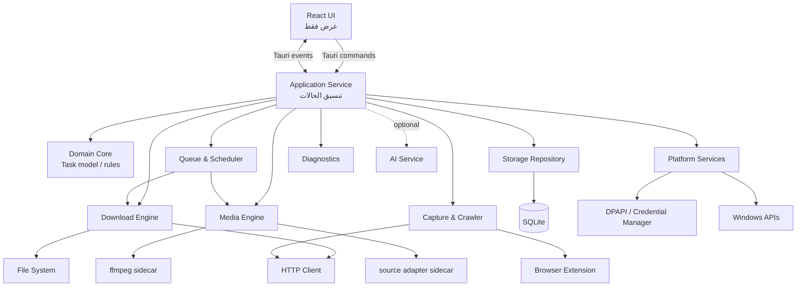

# بنية النظام المقترحة — Tanzeel

| الحقل | القيمة |
| --- | --- |
| الإصدار | 1.0 — تصميم معماري للمراجعة |
| التاريخ | 2026-10-31 |
| الحالة | `DESIGNED` — لا يصف ميزات منفذة إلا حيث يُذكر صراحة |
| المنصة المستهدفة | Windows 10 22H2+ وWindows 11، x64 |
| المرجع الحالي | [ARCHITECTURE.md](../ARCHITECTURE.md) — يخلط بين المنفذ والمقترح |
| الوثائق المرتبطة | [الخارطة](TANZEEL_MASTER_ROADMAP.md)، [الأمان](SECURITY_AND_PRIVACY_PLAN.md)، [الجودة](QUALITY_AND_ACCEPTANCE_STRATEGY.md)، [القرارات](OPEN_DECISIONS.md) |

> **تنبيه:** المرحلة 1 نفّذت الواجهة والنواة وهيكل Tauri وتخزين الإعدادات فقط. المحركات والطابور والزاحف وجسر المتصفح والجدولة **غير منفذة**. هذا المستند تصميم مستقبلي، وليس ادعاء وجود.

---

## 1. مبادئ البنية

1. **فصل الواجهة عن السلطة:** React تعرض وتطلب؛ Rust يتحقق وينفذ ويقرر.
2. **مصدر حقيقة واحد للحالة:** SQLite للبيانات الدائمة، والذاكرة لحالة التشغيل، ولا تُعتبر ملفات المؤقت مصدرًا للحالة.
3. **محرك قابل للاستبدال:** واجهة موحدة للتنزيل، والفيديو، والسحب، والالتقاط.
4. **لا شبكة من الواجهة:** لا `fetch`/`XMLHttpRequest` لموارد خارجية؛ كل شبكة عبر النواة.
5. **لا تنفيذ من نصوص:** لا shell، ولا `eval`، ولا تفسير مخرجات المحركات كأوامر.
6. **الحدود الأمنية أولًا:** كل رابط ومسار وحقل رسالة يُتحقق في النواة.
7. **الاستعادة بالتصميم:** كل عملية كتابة لها حالة قابلة للاستعادة، وكل ملف نهائي يمر بتحقق.
8. **التشخيص بلا خصوصية:** السجلات منقحة، ولا تُرسل تلقائيًا.
9. **التوسع التدريجي:** لا خدمات مصغرة، ولا قاعدة سحابية، ولا تعقيد بلا حاجة.
10. **AI خارج المسار الحرج:** تعطله لا يمنع التنزيل.

---

## 2. الحالة الحالية (المرحلة 1)

هذا هو الواقع المنفذ، وليس الهدف:

```text
React UI (App, pages)
  ├─ i18n (ar/en)
  ├─ localStorage fallback (خارج Tauri فقط)
  └─ invoke('get_settings' | 'save_settings')
            │
            ▼
Tauri commands (apps/desktop/src-tauri/src/lib.rs)
            │
            ▼
tanzeel-core (AppSettings, validation)
            │
            ▼
tanzeel-storage (SQLite, migration 0001_settings.sql)
```

### 2.1 المكونات الحالية

| المكوّن | الموقع | الحالة |
| --- | --- | --- |
| واجهة React | `apps/desktop/src` | `IMPLEMENTED` |
| i18n وRTL | `apps/desktop/src/i18n` و`styles.css` | `IMPLEMENTED + TESTED` جزئيًا |
| أوامر Tauri | `apps/desktop/src-tauri/src/lib.rs` | `IMPLEMENTED + CONNECTED` |
| نواة الإعدادات | `crates/tanzeel-core` | `IMPLEMENTED + TESTED` |
| تخزين SQLite | `crates/tanzeel-storage` | `IMPLEMENTED + TESTED` مكتبيًا |
| ترحيل الإعدادات | `0001_settings.sql` | `IMPLEMENTED + TESTED` |
| الطابور/المحركات | — | `NOT IMPLEMENTED` |

### 2.2 قيود الحالة الحالية

- جدول واحد للبيانات: `settings`.
- `schema_migrations` فقط للترحيل.
- لا WAL، ولا نسخ احتياطي قبل الترحيل.
- لا نموذج مهام.
- لا typed error contract؛ الأخطاء نصوص.
- fallback إلى `localStorage` خارج Tauri قد يخفي فشل الإنتاج.
- `bundle.active=false`؛ لا مثبّت.

---

## 3. البنية المستهدفة



### 3.1 الطبقات

| الطبقة | المسؤولية | لا تفعل |
| --- | --- | --- |
| UI | عرض، تفاعل، i18n، تأكيدات | لا شبكة، لا ملفات، لا قرار أمني |
| Application Service | تنسيق use cases، تحويل الأوامر إلى عمليات | لا تحليل HTTP، لا SQL مباشر |
| Domain Core | Task model، آلة الحالات، قواعد، تحقق | لا I/O مباشر |
| Engines | HTTP/فيديو/سحب/التقاط | لا كتابة SQLite مباشرة |
| Queue/Scheduler | اختيار ما يُشغّل ومتى | لا تنزيل بنفسه |
| Storage Repository | معاملات، ترحيلات، استعلامات | لا قواعد عمل |
| Platform | DPAPI، tray، إشعارات، فتح ملف، registry | لا قرارات منتج |
| Diagnostics | سجلات، مقاييس، تصدير | لا إرسال تلقائي |

**قاعدة الاعتماد:** `UI → application → domain/engines → platform`، و`storage` يُحقن في application/queue فقط. لا تعتمد المحركات على Tauri أو React.

---

## 4. نموذج المهمة الموحد

بدون هذا النموذج، سينشئ كل محرك حالته الخاصة ويتعذر الطابور والسجل والاستعادة.

### 4.1 الكيانات

| الكيان | الوصف |
| --- | --- |
| `Task` | عملية منطقية واحدة: ملف، فيديو، صوت، قائمة، أو دفعة سحب |
| `TaskItem` | عنصر داخل مهمة (فيديو واحد في قائمة، رابط في دفعة) |
| `Segment` | جزء بايتات لتنزيل HTTP مقسم |
| `Schedule` | وقت/تكرار مهمة |
| `ScheduleRun` | فتحة تنفيذ فريدة |
| `CrawlRun` | جلسة سحب صفحة |
| `CrawlLink` | رابط مستخرج بانتظار قرار |
| `HistoryEntry` | سجل نهائي للعرض |
| `DiagnosticEvent` | حدث تشخيص منقح |
| `SecretRef` | مرجع إلى سر في DPAPI، لا السر نفسه |

### 4.2 أنواع المهام

```text
HttpFile    — ملف مباشر
Video       — مصدر فيديو واحد
Audio       — استخراج/تنزيل صوت
Playlist    — مجموعة TaskItem
SiteBatch   — مجموعة روابط من صفحة
```

### 4.3 آلة الحالات

```text
CREATED
  └─> QUEUED
        ├─> RESOLVING
        │     ├─> DOWNLOADING
        │     ├─> PROCESSING
        │     └─> FAILED
        ├─> PAUSED
        ├─> RETRY_WAIT
        └─> CANCELLED

DOWNLOADING
  ├─> VERIFYING
  │     ├─> PROCESSING
  │     ├─> COMPLETED
  │     └─> FAILED
  ├─> PAUSED
  ├─> RETRY_WAIT
  └─> CANCELLED

PROCESSING
  ├─> COMPLETED
  ├─> FAILED
  └─> CANCELLED

PAUSED ─> QUEUED
RETRY_WAIT ─> QUEUED
RECOVERING ─> PAUSED | QUEUED | FAILED
```

**قواعد:**

- `COMPLETED` نهائية، ولا تعود إلا بمهمة جديدة.
- `CANCELLED` نهائية؛ لا استئناف ضمني.
- `FAILED` قابلة لإعادة المحاولة مع إعدادات جديدة أو محفوظة.
- `PAUSED` لا تعني فشلًا.
- `RECOVERING` تُستخدم بعد إعادة تشغيل غير نظيفة، ولا تُعرض كنجاح.
- لا انتقال إلى `COMPLETED` قبل تحقق الحجم/البصمة.
- كل انتقال يُسجل مع الوقت والسبب.

---

## 5. محرك التنزيل المباشر

### 5.1 الحدود

`tanzeel-download` مسؤول عن HTTP والبايتات والأجزاء. لا يعرف SQLite ولا UI. يتلقى `DownloadRequest` ويعيد أحداثًا/نتيجة.

```text
DownloadRequest {
  task_id, url, destination, headers?, credentials_ref?,
  max_connections, max_segments, retry_policy, cancel_token
}
DownloadOutcome {
  bytes_written, content_type?, etag?, last_modified?,
  integrity, final_path, warnings[]
}
```

### 5.2 خوارزمية مختصرة

1. تحقق من الرابط والمخطط والطول والعنوان (SSRF).
2. أرسل طلبًا لاكتشاف الحجم/النطاقات/ETag، دون تنزيل كامل.
3. إذا كان `Range` مدعومًا و`206` صالحًا و`Content-Length` مؤكدًا:
   - احسب أجزاء ثابتة العدد (لا تكيفي في v1).
   - أنشئ ملفات/مقاطع مؤقتة.
   - شغّل الأجزاء ضمن حدود كلية/لكل مضيف.
   - أعد المحاولة للأخطاء العابرة مع `Retry-After`.
4. وإلا: نزّل باتصال واحد.
5. عند الإيقاف: احفظ حالة الأجزاء؛ عند الإلغاء: نظّف أو أبقِ وفق السياسة.
6. عند الاكتمال: تحقق من الحجم ومجموع الأجزاء وETag/Last-Modified.
7. ادمج/أعد التسمية ذريًا إلى المسار النهائي.
8. سجّل النتيجة؛ لا تُعلن النجاح قبل التحقق.

### 5.3 قرارات ثابتة

- لا تقسيم بلا `Accept-Ranges`/`206`/حجم صالح.
- لا `Content-Length` موثوق يعني اتصالًا واحدًا.
- لا استئناف إذا تغيّر الملف على الخادم؛ أعد البدء بأمان.
- لا تحميل الملف كاملًا في الذاكرة.
- لا ترويسات من المستخدم دون تحقق ومنع حقن CRLF.
- لا cookies افتراضيًا؛ القرار في [OPEN_DECISIONS.md](OPEN_DECISIONS.md).
- لا وعود سرعة؛ القياس فقط.

### 5.4 الأخطاء المصنفة

| الفئة | أمثلة | قابلة لإعادة المحاولة |
| --- | --- | --- |
| إدخال | مخطط غير مدعوم، مسار خبيث | لا |
| شبكة عابرة | مهلة، انقطاع، `5xx` | نعم |
| ضغط خادم | `429`/`503` مع `Retry-After` | نعم مع تباعد |
| مصادقة | `401`/`403` | لا افتراضيًا |
| محتوى | `404`، نوع غير متوقع، حجم متناقض | لا/حسب الحالة |
| قرص | ممتلئ، صلاحية | لا حتى المعالجة |
| سلامة | بصمة/حجم غير مطابق | أعد التنزيل |
| إلغاء | طلب مستخدم | لا |

---

## 6. محرك الفيديو والوسائط

### 6.1 الحدود

- `tanzeel-media` ينسق التحليل والتنزيل والمعالجة، ولا يكتب SQLite.
- محوّل المصدر (مثل `yt-dlp`) عملية فرعية معزولة أو مكتبة، حسب قرار ADR-0004.
- `ffmpeg` أداة منفصلة للدمج/التحويل.

### 6.2 المسار

```text
Analyze URL
  -> adapter returns metadata (formats, durations, URLs)
  -> validate + show available formats
  -> user selects
  -> download selected streams via HTTP engine or adapter
  -> verify
  -> optional ffmpeg merge/transcode
  -> verify output
  -> atomic rename
```

### 6.3 ضوابط إلزامية

- وسائط مصفوفة، لا shell.
- `--ignore-config` ونظيرها حسب المحرك، ومنع `--exec`.
- مهلة، حد مخرجات، قتل شجرة العمليات، وسائط بيئة محدودة.
- التحقق من بصمة/إصدار الأداة.
- عدم تفسير مخرجات الأداة كأوامر.
- عدم تشغيل الملف الناتج.
- لا DRM ولا تجاوز حماية.
- فشل الدمج لا يحذف المصدر.
- البيانات الوصفية غير موثوقة؛ تُنقّى للعرض.

---

## 7. الطابور والجدولة

### 7.1 الطابور

- يدير `QUEUED` ويختار المهمة التالية حسب الأولوية والوقت.
- يطبق حدود: تنزيلات متزامنة، اتصالات كلية/لكل مضيف، سرعة.
- يمنع تعارض المسار النهائي.
- يوقف/يستأنف/يلغي عبر إشارات، لا بقتل الواجهة.
- يستعيد من SQLite عند البدء.

### 7.2 الجدولة

- داخل التطبيق فقط في v1؛ لا خدمة ولا Task Scheduler افتراضيًا.
- UTC محفوظ + المنطقة الزمنية.
- `schedule_runs` بمعرّف فتحة فريد يمنع التكرار.
- ساعة قابلة للحقن للاختبار.
- سياسة الفائت: «شغّل عند أول فرصة» أو «علّمها فائتة» — قرار مستخدم.
- فحص المساحة/الصلاحيات قبل التشغيل.

---

## 8. الالتقاط والمتصفح والزاحف

### 8.1 مسار الالتقاط

```text
Browser Extension (فعل مستخدم)
  -> Native Messaging (stdin/stdout, بلا منفذ)
  -> tanzeel-capture validation
  -> pending Task/Item
  -> UI preview + user confirmation
  -> queue
```

- تحقق من معرّف الإضافة والمسار والحجم والمخطط والحقول.
- لا تنزيل تلقائي.
- لا cookies أو تاريخ تصفح.
- تعطيل افتراضي.
- تسجيل المضيف في `HKCU` لكل مستخدم.

### 8.2 الزاحف

- HTML ثابت فقط، صفحة واحدة، نطاق أصلي، عمق 1.
- `robots.txt`، حد معدل، `User-Agent`.
- منع SSRF والعناوين الخاصة.
- حد حجم/روابط.
- معاينة قبل التنزيل.
- لا JS، لا جلسات، لا paywall.

---

## 9. التخزين ونموذج البيانات

### 9.1 القواعد

- SQLite هو المصدر الدائم للمهام/الإعدادات/السجل/الجدولة.
- الملفات نفسها على القرص، وSQLite يحفظ مساراتها وحالتها.
- لا BLOB للملفات.
- كتابة واحدة منطقية عبر repository/كاتب واحد.
- معاملات قصيرة، `foreign_keys=ON`، `busy_timeout`، وWAL **مقترح** (غير مفعّل حاليًا).
- ترحيلات إلى الأمام فقط، مع نسخة احتياطية قبل الترقية.
- لا حذف تلقائي لملفات المستخدم عند ترقية/تلف قاعدة.

### 9.2 الجداول المقترحة

| الجدول | الغرض |
| --- | --- |
| `schema_migrations` | إصدارات الترحيل (موجود) |
| `settings` | إعدادات المستخدم (موجود) |
| `tasks` | المهمة الأم |
| `task_items` | عناصر القوائم/الدفعات |
| `task_segments` | حالة الأجزاء للاستئناف |
| `schedules` | الجدولة |
| `schedule_runs` | منع التكرار |
| `crawl_runs` | جلسات السحب |
| `crawl_links` | روابط بانتظار التأكيد |
| `history` | سجل نهائي |
| `diagnostic_events` | أحداث منقحة |
| `secret_refs` | مرجع DPAPI فقط |

### 9.3 الاستعادة بعد الانهيار

1. افتح SQLite وتحقق من السلامة.
2. اقرأ المهام غير النهائية.
3. طابقها مع ملفات `.part` والمسارات النهائية.
4. إذا كان الملف النهائي موجودًا ومطابقًا: أكمل/أصلح الحالة.
5. إذا كان المؤقت صالحًا: ضع المهمة في `PAUSED` أو `RECOVERING`.
6. إذا كان المؤقت تالفًا/ناقصًا: علّمها `FAILED` مع سبب، ولا تقدم ملفًا تالفًا.
7. نظّف اليتيم وفق سياسة معلنة.
8. لا تشغّل تلقائيًا ما لم تثبت السلامة.

---

## 10. واجهات IPC والعقود

### 10.1 الأوامر الحالية

| الأمر | الحالة |
| --- | --- |
| `get_settings` | `IMPLEMENTED + CONNECTED` |
| `save_settings` | `IMPLEMENTED + CONNECTED` |

### 10.2 الأوامر المقترحة

| الأمر | الغرض |
| --- | --- |
| `analyze_url` | تحليل رابط بلا تنزيل |
| `create_task` | إنشاء مهمة بعد تحقق |
| `start_task` / `pause_task` / `resume_task` / `cancel_task` | دورة حياة |
| `retry_task` | إعادة محاولة |
| `list_tasks` / `get_task` | عرض/تفاصيل |
| `pause_all` / `resume_all` / `cancel_all` | تحكم جماعي |
| `get_settings` / `save_settings` | إعدادات (موجود) |
| `schedule_task` / `cancel_schedule` | جدولة |
| `start_crawl` / `confirm_crawl` / `cancel_crawl` | سحب |
| `open_file` / `open_folder` | فتح آمن |
| `delete_history` | حذف سجل لا ملفات |
| `get_diagnostics` / `export_diagnostics` | تشخيص |
| `get_capabilities` | ما هو مدعوم فعلًا |

### 10.3 الأحداث

- `task:updated` — حالة/ملخص.
- `task:progress` — تقدم مخفف.
- `queue:changed`.
- `crawl:updated`.
- `diagnostic:event` (اختياري).
- `app:error` — خطأ منقح.

**قواعد العقد:**

- `serde` camelCase، حقول معروفة، رفض الحقول الإضافية حيث يناسب.
- لا تمرير مسار/أمر خام إلى المحرك.
- لا تعتمد الواجهة على نصوص أخطاء؛ تعتمد رمزًا مترجمًا.
- كل أمر يتحقق من الصلاحية والحالة.
- حقول الملفات/الروابط محدودة الطول والنوع.
- لا أحداث عالية التردد أكثر من 2/ثانية.

---

## 11. نظام الملفات والمنصة

### 11.1 المسارات

- مجلد التنزيل الافتراضي: Downloads النظام عند القيمة الفارغة.
- كل الكتابات داخل جذر تنزيل مُتحقق.
- منع `..`، المسارات المطلقة من UI، نقاط إعادة التحليل، وأسماء الأجهزة المحجوزة.
- اسم نهائي مُنقّى، مع امتداد آمن.
- إعادة تسمية ذرية على نفس وحدة التخزين.
- مؤقتات في مجلد الوجهة أو مجلد عمل مُدار.

### 11.2 خدمات المنصة

| الخدمة | الاستخدام |
| --- | --- |
| DPAPI/Credential Manager | أسرار/cookies عند اعتمادها |
| Job Objects | قتل شجرة العمليات |
| Notifications | اكتمال/فشل، دون فتح ملف تلقائي |
| Tray | تشغيل/إخفاء/إغلاق |
| Shell open | فتح ملف/مجلد بعد تحقق |
| Registry HKCU | تسجيل Native Messaging لكل مستخدم |
| Windows version check | توافق Win10 22H2+ |

---

## 12. الأمان والحدود

- UI غير موثوقة من منظور النواة.
- كل رابط يُتحقق مركزيًا: مخطط، طول، ترميز، تحويلات، IP خاص.
- لا وصول إلى `localhost`/الشبكة المحلية افتراضيًا.
- لا shell/no `eval`/no تنفيذ ملف منزّل.
- لا تسجيل cookies/tokens/مسارات كاملة.
- لا تثبيت تحديث غير موقّع.
- أقل صلاحيات، لا admin افتراضيًا.
- threat model في [SECURITY_AND_PRIVACY_PLAN.md](SECURITY_AND_PRIVACY_PLAN.md).

---

## 13. نموذج الأخطاء

```text
AppError {
  code: "NETWORK_TIMEOUT" | "DISK_FULL" | ...,
  category: Input | Network | Storage | Engine | Security | Unknown,
  retryable: bool,
  user_message_key: string,
  safe_details?: string
}
```

- لا تعتمد الواجهة على `startsWith` أو نصوص حرة.
- التفاصيل التقنية تُسجل منقحة، لا تُعرض خامًا.
- كل خطأ له رسالة عربية/إنجليزية.
- الأخطاء غير المتوقعة تُصنف `Unknown` ولا تُخفى.

**دين حالي:** `SettingsPage` يفحص بادئة `invalid-settings:`، وهذا هش؛ يُستبدل بعقد typed.

---

## 14. المراقبة والتشخيص

- logger موحد بمستويات، دوّار، وحد حجم.
- أحداث تشخيص منقحة: رمز، فئة، محاولة، زمن، حجم — لا URL كامل افتراضيًا.
- مقاييس محلية: بدء، ذاكرة، CPU، سرعة.
- حزمة تصدير محلية فقط.
- لا telemetry افتراضية.
- التفاصيل في [SECURITY_AND_PRIVACY_PLAN.md](SECURITY_AND_PRIVACY_PLAN.md).

---

## 15. عزل AI

- خدمة اختيارية خارج مسار التنزيل.
- لا استدعاء تلقائي في الخلفية.
- موافقة صريحة لكل نوع بيانات.
- تنقية URL/headers/cookies قبل أي إرسال.
- فشل مغلق: لا تعطيل للتنزيل.
- لا تنفيذ إجراءات نيابة عن المستخدم.
- سجل مكالمات منقح.
- القرار: [OPEN_DECISIONS.md](OPEN_DECISIONS.md).

---

## 16. التحديث والإصدار

- بناء من GitHub Actions فقط.
- مثبّت NSIS لكل مستخدم.
- توقيع الكود إن توفرت شهادة، وإلا إعلان صريح.
- بيان تحديث موقّع، ورفض المصدر/التوقيع الخاطئ.
- تراجع بسحب الإصدار.
- إزالة تسجيل Native Messaging عند الإلغاء.
- SBOM/checksums/تراخيص مع كل إصدار.

---

## 17. مسارات البيانات

### 17.1 تنزيل مباشر

```text
UI create_task -> validate -> DB(created/queued)
 -> queue picks -> engine probe -> DB(resolving)
 -> engine download -> events -> DB(progress/segments)
 -> verify -> DB(verifying) -> atomic rename
 -> DB(completed) -> history -> event
```

### 17.2 فيديو

```text
UI analyze -> adapter -> validated metadata -> user selects
 -> create_task -> engine/adapter download -> verify
 -> optional ffmpeg -> verify -> completed
```

### 17.3 متصفح

```text
extension action -> native host -> validate -> pending item
 -> UI preview/confirm -> queue -> normal download
```

### 17.4 سحب

```text
UI start_crawl -> validate URL -> fetch HTML -> parse
 -> dedupe/limits -> preview -> user selects -> tasks
```

---

## 18. الأداء والتزامن

| المجال | الهدف المؤقت | الحالة |
| --- | --- | --- |
| بدء التطبيق | < 3 ثوانٍ | **لم يُختبر** |
| الذاكرة الخاملة | < 200MB | **لم يُختبر** |
| تحديث التقدم | 2/ثانية | **لم يُختبر** |
| تجميد الواجهة | لا تجميد أثناء I/O | **لم يُختبر** |
| تنزيل متزامن | 3 افتراضيًا | **لم يُختبر** |
| أجزاء/ملف | 8، حد 16 | **لم يُختبر** |
| اتصالات/مضيف | 6 | **لم يُختبر** |
| اتصالات كلية | 32 | **لم يُختبر** |

- العمليات الثقيلة خارج خيط الواجهة.
- backpressure على الأحداث.
- ذاكرة مستقلة عن حجم الملف.
- قياس على جهاز مرجعي، لا وعود.

---

## 19. مسار الترحيل من الحالة الحالية

1. أبقِ `settings` و`get_settings`/`save_settings` كما هما، مع عقد أخطاء typed لاحقًا.
2. أضف `tanzeel-download` ونموذج المهمة في المرحلة 2، مع ترحيل جديد.
3. أضف repository/queue في المرحلة 4؛ لا تكتب المحركات SQL مباشرة.
4. أضف `tanzeel-media` و`tanzeel-capture` في مراحل 5–8.
5. أضف diagnostics في 12.
6. لا تعِد كتابة الواجهة؛ وسّعها تدريجيًا.
7. كل ترحيل DB جديد append-only، مع اختبار ترقية ونسخة احتياطية.

---

## 20. قرارات مفتوحة

- محرك الفيديو (ADR-0004).
- محرك HTTP/مكتبة/وقت تشغيل غير متزامن.
- WAL/نسخ احتياطي/رجوع.
- cookies/auth.
- Task Scheduler.
- أول متصفح/توزيع الإضافة.
- AI ومزوده.
- التوقيع والتحديث.
- الحدود الافتراضية للسرعة/الاتصالات.
- سياسة الاحتفاظ.

التفاصيل في [OPEN_DECISIONS.md](OPEN_DECISIONS.md).

---

## 21. خارج النطاق

- خدمات مصغرة أو خادم مركزي.
- مزامنة سحابية أو حساب مستخدم.
- DRM/tجاوز حماية.
- مشغل وسائط أو محرر فيديو.
- زحف واسع/JS.
- منفذ localhost لجسر المتصفح.
- تنفيذ ملفات منزلة.
- دعم «كل المواقع» بلا اختبار.
